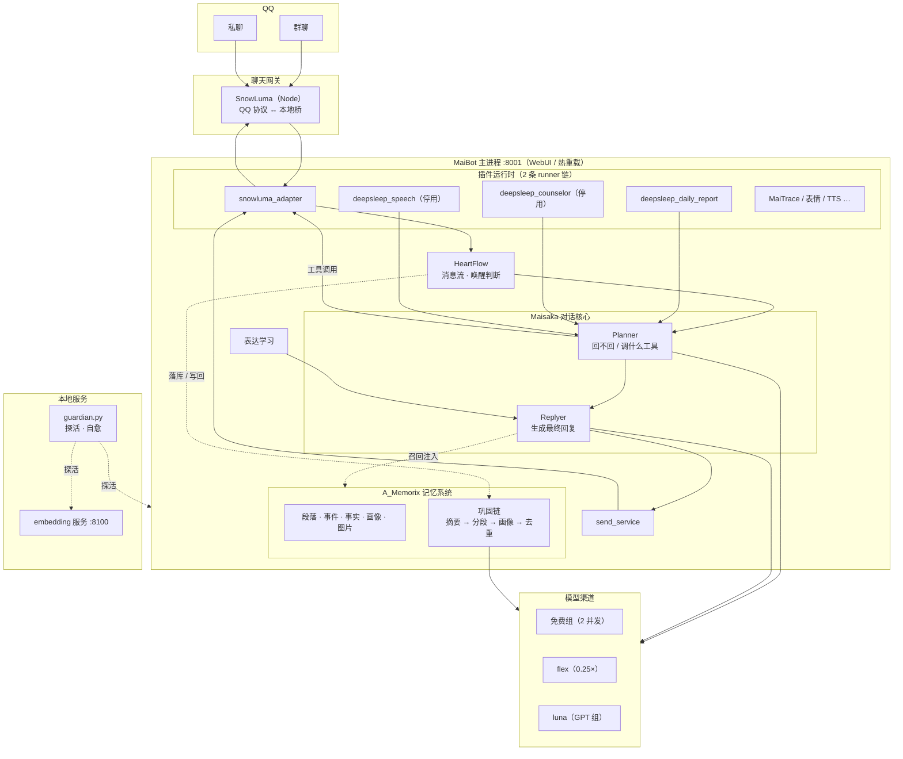
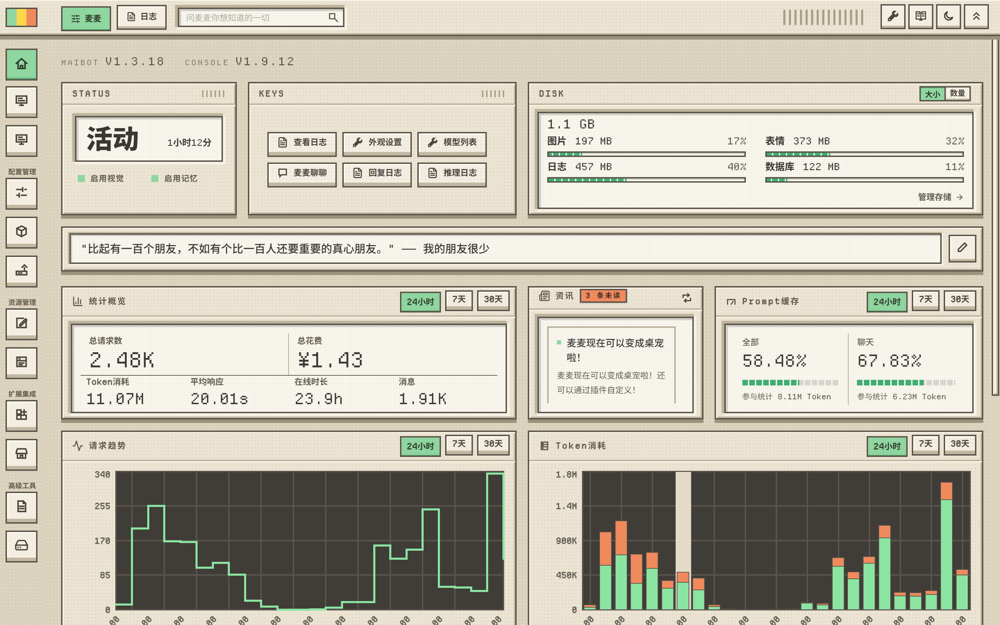
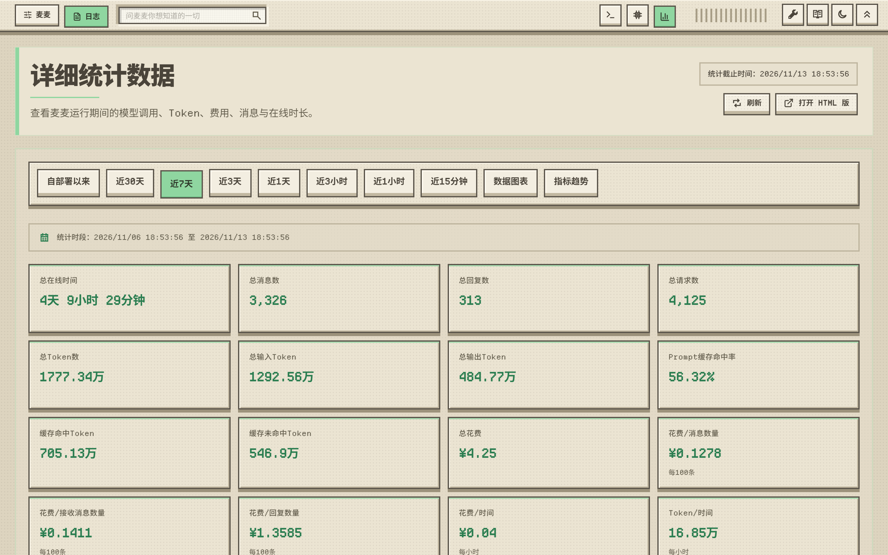
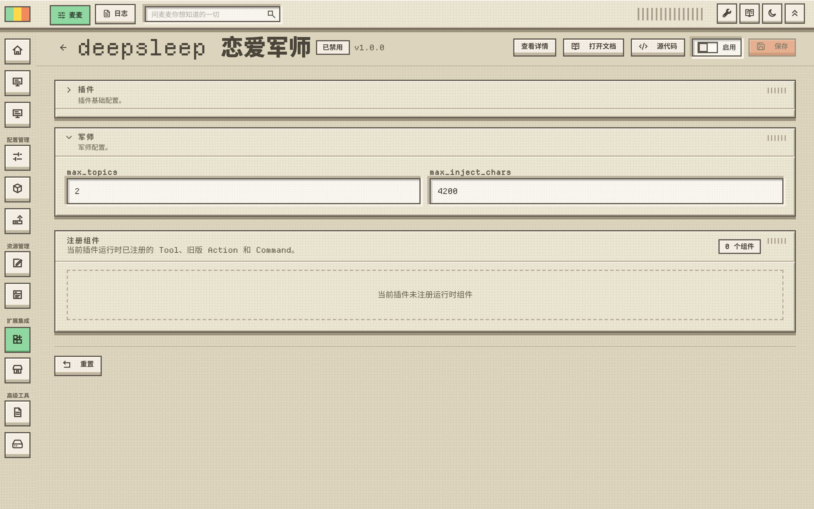

# deepsleep · 住在一台 Windows 主机里的 QQ 少女

一个 **MaiBot 人格化改造**的完整实践：3 个自研插件、28 个文件的上游源码补丁、一套被反复调教过的记忆与表达系统。

> **English** — deepsleep is a persona-driven QQ chatbot built on [MaiBot](https://github.com/Mai-with-u/MaiBot): custom memory retrieval & decay, expression learning feedback, reply-safety guards, and three plugins (usage report, retrieval-based counselor, speech-card injector). This repo is a sanitized snapshot of that work — no keys, no chat data.

deepsleep（中文自称「深眠」/「小睡」）是跑在 Windows 上的私人 QQ 机器人。本仓库不是 MaiBot 框架本身，而是建立在它之上的一整套"养成"工作——如何让一个通用聊天框架，长成一个说话像人、记得住事、有自己脾气和边界的角色。

## 仓库内容

```
patches/            相对 MaiBot 上游的源码补丁（28 个文件，含 1 个新文件）
tests/              离线单元测试（7 组 / 112 项，AST 提取源码运行）
images/             界面截图
plugins/            3 个自研插件：每日用量日报 / 恋爱军师（停用）/ 说话提示（停用）
config-templates/   配置模板：bot_config / model_config（全部占位符，无密钥）
scripts/            守护进程、embedding 服务、Windows 启动脚本
docs/               设计与实施记录（含 24 万字部署日记的脱敏版）
LICENSE             GPL-3.0（继承 MaiBot 上游）
NOTICE.md           第三方与许可说明
```

## 架构



更多图（消息时序、记忆读写链、说话分层）见 [docs/architecture.md](docs/architecture.md)；完整版静态图（可缩放、含端口与任务链）：[docs/architecture-full.svg](docs/architecture-full.svg)。

## 界面







## 三个插件

| 插件 | 作用 | 状态 |
|---|---|---|
| `deepsleep_daily_report` | 每日 0 点把前一天 token 用量与费用按会话/模型/任务分类私聊给主人；对话中可直接查询今日开销（宿主注入身份鉴权，防伪造） | 启用 |
| `deepsleep_counselor` | 关系/社交话题的深度知识按需检索（关键词命中 + 危机信号强制安全指引）| 停用（结构保留） |
| `deepsleep_speech` | replyer/planner 请求前按处境注入"说话提示"；支持指定用户通道 | 停用（结构保留） |

后两个插件的知识正文（约 30 万字的第三方知识库衍生内容）按许可证要求**未随仓库发布**，仅保留程序结构；`knowledge/` 与 `cards/` 目录里有自建格式说明。

## 测试

`tests/` 里有 7 组离线单元测试（共 112 项）：AST 提取源码函数在内存里跑，不联网、不写库、不调模型。运行方式见 [tests/README.md](tests/README.md)。

```bash
set DEEPSLEEP_WORKSPACE=D:\deepsleep
python tests/test_speech_injector.py
```

## 相对 MaiBot 上游的改动

基线 **MaiBot v1.3.18（2026-10）**，28 个文件、约 870 行改动（见 `patches/0001-maibot-deepsleep-customizations.patch`）。

- **记忆系统**：注入侧占位/近重复过滤与跨会话配额、检索遥测、段落时效衰减（24h 半衰期，取访问前快照避免结构性空转）、写侧占位总结拦截、画像与事实写回的模型链拆分
- **表达学习**：快模式语境加权、反馈闭环（被怼 -1 / 表情回应 +1）、黑话毕业线调整
- **回复安全**：工具协议文本泄露拦截（`<tool_call>` 等模式三阶段拒发）
- **插件运行时**：宿主上下文注入（防模型伪造身份）、模型任务注册（`memory_episode`）、供应商并发限制

## 记忆系统（A_Memorix 上的工作）

检索零 LLM：向量（Qwen3-Embedding-0.6B 本地）+ BM25 + 图 PPR 三路融合。所有花费在写入侧巩固链。改造要点：

- 摘要触发自适应（攒满 60 条或 15 条且距上次 ≥6h），冷群不断更
- 段落召回时效衰减：24h 半衰期、下限 0.15、只在排序层生效不破召回集
- 注入去重：字符 bigram 近重复抑制 + 占位说明过滤（≤120 字且特征词 ≥2）
- 检索遥测：`记忆检索遥测: mode= hits= duration_ms=`，无查询正文
- 查询蒸馏：用摘要式查询替代原始消息拼接，hit@5 从 22.5% → 97.5%

## 表达与说话

- 表达学习：从群聊提取"情景 + 风格"候选，快模式按语境加权选择
- 说话守则与人格分层：Planner 读 `behavior_style`、Replyer 读 `reply_style`、人格两处都读——**态度类改动必须同时落在人格与行为层**（这条踩坑记录在 `docs/说话方式注入_20261113.md`）
- 反工具泄露：回复里出现 `<tool_call>` 一类协议文本时三阶段拦截并要求重新生成

## 运维

- `guardian.py`：每 3 分钟探测 8001/8100 端口，连续失败自动拉起
- `embedding_server.py`：本地 embedding 服务（fastembed，:8100）
- `scripts/*.bat`：隐藏窗口启动（`wscript` + `WScript.Shell.Run`，Windows 下唯一稳定的无窗口方案）
- 踩坑合集见 `docs/部署说明.md` 与各实现记录

## 文档

`docs/` 里是全部设计与实施记录；`部署说明.md` 是 24 万字的完整搭建日记（已脱敏）。建议从这几篇读起：

- `deepsleep记忆系统设计文档.md`
- `说话方式注入_20261113.md`（三个插件的设计演进与教训）
- `段落时效衰减_20261113.md`、`记忆去重修复_20261112.md`
- `恋爱军师接入_20261113.md`

## 脱敏与隐私

发布前已做脱敏：**QQ 号 / 群号替换为占位符，API 密钥全部清空为 `<YOUR_API_KEY>`，聊天记录、记忆库（`MaiBot/data`）、日志、人设图均未包含**。人格设定中的人名系虚构人设。

## 许可

- 本仓库代码为 **GPL-3.0**（继承 MaiBot 上游许可）
- 「狗头军师」知识库（PolyForm Noncommercial 1.0.0）的衍生内容**未随仓库发布**
- SnowLuma 聊天网关及 MaiBot 框架本身不包含在本仓库，请从各自上游获取

## 快速开始

1. 克隆 [MaiBot](https://github.com/Mai-with-u/MaiBot) 并按其文档完成基础部署
2. 应用补丁：`git apply patches/0001-maibot-deepsleep-customizations.patch`，再把 `patches/new-files/src/learners/expression_feedback.py` 放到对应位置
3. 复制 `config-templates/*.toml` 到 `MaiBot/config/`，填入自己的密钥与账号（字段说明见 [config-templates/README.md](config-templates/README.md)）
4. 插件目录复制到 `MaiBot/plugins/`（知识库正文需自建，见各插件 README）
5. 启动本地 embedding 服务与 MaiBot（启动顺序与依赖见 [scripts/README.md](scripts/README.md)）

> 本项目为个人兴趣实践，不提供开箱即用的托管服务。
